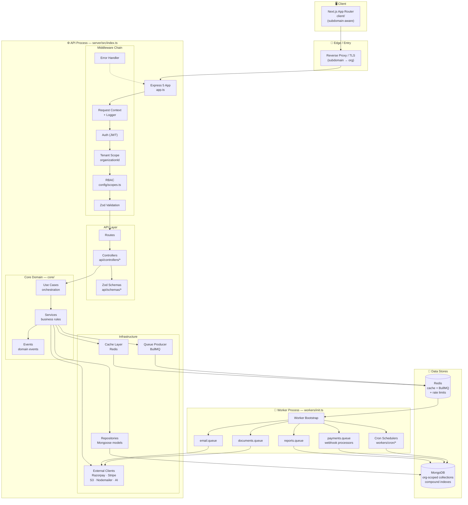
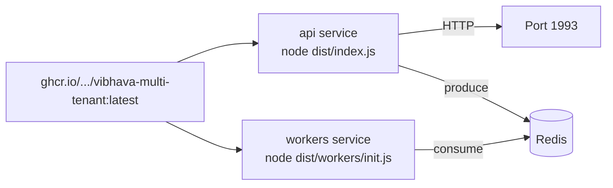
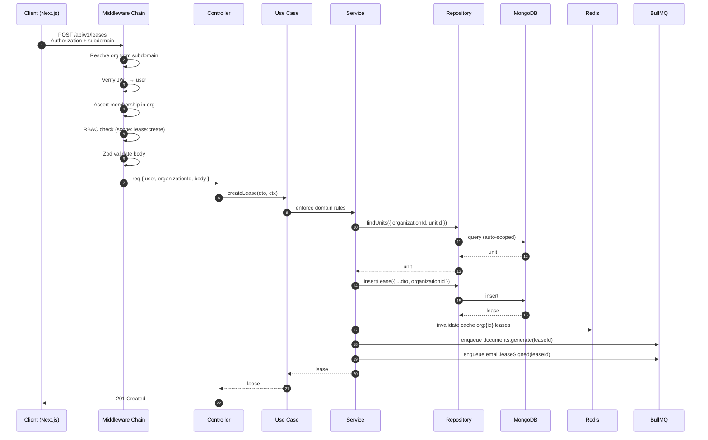
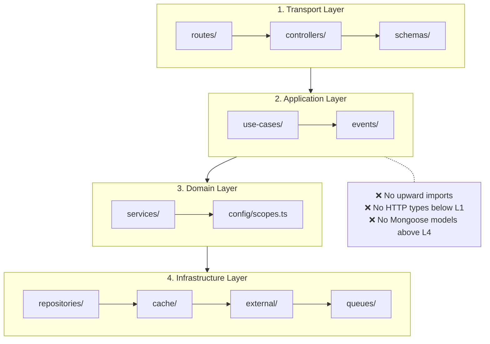
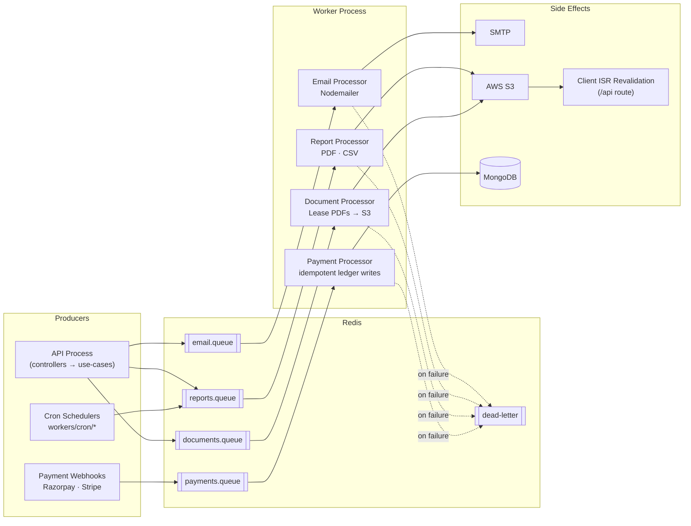
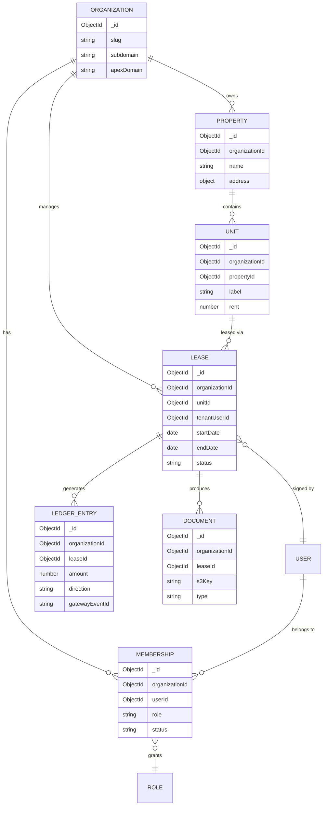
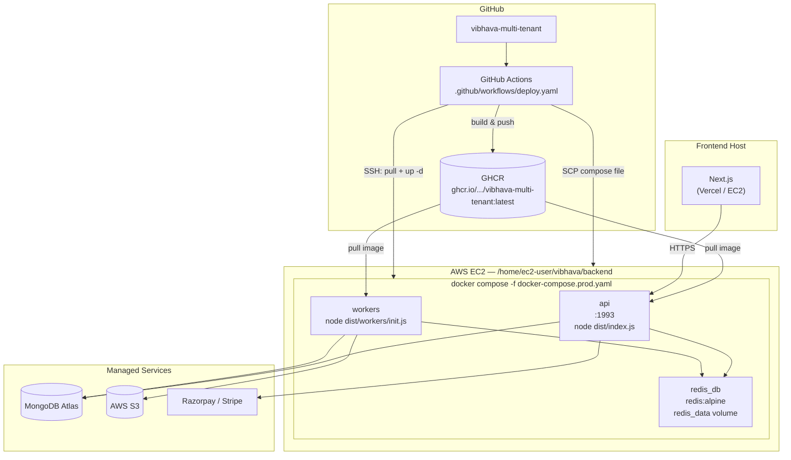

# Architecture — Vibhava Estate Systems

> Backend architecture reference for `vibhava-multi-tenant`.
> For setup and usage, see the [README](../README.md).

---

## Table of Contents

1. [Design Goals](#1-design-goals)
2. [System Overview](#2-system-overview)
3. [Process Model](#3-process-model)
4. [Request Lifecycle](#4-request-lifecycle)
5. [Multi-Tenancy Enforcement](#5-multi-tenancy-enforcement)
6. [Layering Rules](#6-layering-rules)
7. [Async Workers & Queues](#7-async-workers--queues)
8. [Data Model (Tenant-Scoped)](#8-data-model-tenant-scoped)
9. [Deployment Topology](#9-deployment-topology)
10. [Key Design Decisions](#10-key-design-decisions)
11. [Folder Map](#11-folder-map)

---

## 1. Design Goals

The architecture optimizes for four things, in order:

1. **Provable tenant isolation** — a developer should not be able to leak data even by accident.
2. **Fast request path** — the API must stay responsive under dashboard load; heavy work is deferred.
3. **Independent scaling** — the async workload profile is fundamentally different from the request profile.
4. **Cheap deploys** — one image, two entrypoints, one compose file, one pipeline.

Everything below is a consequence of these four.

---

## 2. System Overview



**Reading this diagram:** traffic enters through the reverse proxy, which resolves the tenant from the subdomain. The Express app runs a fixed middleware chain before any controller. Domain logic lives in `core/`, and all I/O (Mongo, Redis, S3, payment gateways) sits behind the infrastructure layer. The worker process shares no memory with the API — it communicates only through Redis and Mongo.

---

## 3. Process Model

The single most important architectural decision:

> **One Docker image, two entrypoints.**

| Process | Entrypoint | Purpose | Scale profile |
|---|---|---|---|
| `api` | `node dist/index.js` | HTTP request handling | Scales with traffic |
| `workers` | `node dist/workers/init.js` | Job processing, cron, webhooks | Scales with queue depth |

Both run the same compiled `dist/`, share the same domain logic, and use the same env config. They differ only in what they bootstrap.

**Why this matters:**

- **No logic drift.** A repository method used by the API is the *same* method used by a worker. There is no "worker copy" of anything.
- **Independent scaling.** Under report-generation load, you add worker containers without over-provisioning API capacity (and vice versa).
- **Simple deploys.** One image build, one push to GHCR, two `docker compose` services referencing the same tag.
- **Graceful shutdown parity.** Both processes use the same SIGTERM handler for draining.



**Trade-off accepted:** a cold-start cost of ~2s for workers because they load the full domain bundle. In exchange, we avoid duplicating business logic in a separate "jobs package" — which historically is where tenant-scoping bugs hide.

---

## 4. Request Lifecycle

Tracing a single write request through the system:



**Key invariants:**

- `organizationId` is resolved by middleware and placed on the request context. **It is never read from the request body.**
- The controller does no business logic — it validates input, calls one use-case, and returns.
- Side effects that can fail independently (PDF generation, email) are enqueued, not awaited.
- Cache invalidation happens *before* the response returns, so the next read is guaranteed fresh.

---

## 5. Multi-Tenancy Enforcement

Isolation is not a convention — it's enforced at three layers.

### Layer 1 — Tenant resolution (middleware)

The subdomain is mapped to an `organizationId` before any controller runs. Unknown subdomains short-circuit with 404.

### Layer 2 — Membership check (middleware)

The authenticated user must have an active membership in the resolved organization. Roles are per-membership, not per-user, so a user in two orgs has two independent role sets.

### Layer 3 — Repository scoping (data layer)

Every tenant-scoped collection requires `organizationId` in its filter. A Mongoose plugin injects it automatically:

```ts
// server/src/infrastructure/database/plugins/tenantScope.ts
schema.pre(/^find|^count|^update|^delete/, function (next) {
  if (this.getOptions().skipTenantScope) return next();
  this.where({ organizationId: getContext().organizationId });
  next();
});
```

The `skipTenantScope` escape hatch exists only for platform-admin operations and is audit-logged.

### The isolation contract

| Rule | Enforced by | Violation test |
|---|---|---|
| Request carries valid org context | Middleware | Integration test: no subdomain → 404 |
| User belongs to org | Middleware | Integration test: cross-org JWT → 403 |
| Queries scoped to org | Mongoose plugin | Unit test: cross-org `find` returns empty |
| Writes include `organizationId` | Schema `required: true` | Schema validation error |

> **Note:** These four rules are the ones to point at if asked "how do you *know* data is isolated?" Every one has a test.

---

## 6. Layering Rules



**The rule:** dependencies point **downward only**.

- `controllers/` may import from `use-cases/` — never the reverse.
- `use-cases/` may import from `services/` — never from `express` or `mongoose`.
- `services/` express business rules with no knowledge of HTTP, ORM, or transport.
- `repositories/` are the only place Mongoose is imported.

**Why this rule exists:** it makes services testable without spinning up Express or a database, and it makes it *impossible* for a controller to bypass tenant scoping by querying Mongo directly.

---

## 7. Async Workers & Queues



### Job contracts

| Queue | Producer | Consumer | Idempotent? | Retries |
|---|---|---|---|---|
| `email.queue` | API, workers | Email processor | Yes (message ID) | 3, exp backoff |
| `reports.queue` | API, cron | Report processor | No (regenerated) | 2 |
| `documents.queue` | API | Document processor | Yes (leaseId + version) | 3 |
| `payments.queue` | Webhook handler | Payment processor | **Yes (event.id as jobId)** | 5, exp backoff |

### The idempotency rule

Payment webhooks use the gateway's `event.id` as the BullMQ `jobId`. If the gateway retries, BullMQ deduplicates. If the processor crashes mid-write, the retry is a no-op because the ledger entry is keyed by event ID.

**This is the only queue where correctness under retry is non-negotiable.**

---

## 8. Data Model (Tenant-Scoped)

Every collection below carries `organizationId` as a required, indexed field.



**Indexing strategy:** every compound index is prefixed with `organizationId`. This means Mongo can never serve a query that spans tenants without an explicit `$in` on organization IDs — which the tenant-scope plugin blocks.

```js
// Example: lease lookups for a dashboard
{ organizationId: 1, status: 1, endDate: 1 }
```

---

## 9. Deployment Topology



**Pipeline contract:**

1. On push to `main`, Actions builds the Docker image from `./server`.
2. Image is pushed to **GitHub Container Registry** with the `latest` tag.
3. `docker-compose.prod.yaml` is **SCP'd** to `/home/ec2-user/vibhava/backend` on the EC2 host.
4. Actions SSHs in, logs into GHCR, pulls the new image, and runs `docker compose up -d --remove-orphans`.

**Why SCP the compose file rather than baking it into the image:** infrastructure config lives in the repo, versioned alongside code. Rollback is `git revert` + re-run — not an SSH session.

---

## 10. Key Design Decisions

| Decision | Alternative considered | Why we chose this |
|---|---|---|
| One image, two entrypoints | Separate `worker` package | Prevents domain-logic drift; worker uses the same repository methods as the API |
| Shared collection + `organizationId` | DB-per-tenant | Cost and operational simplicity; isolation enforced at the data layer, not the cluster layer |
| Mongoose `pre` hook for scoping | Manual `organizationId` in every query | Manual filtering fails eventually; hooks fail loudly instead |
| Subdomain-based tenant resolution | Header-based (`X-Organization-Id`) | Subdomains are user-visible and cacheable; headers are trivially spoofed if middleware is missing |
| BullMQ on Redis | Mongo-backed job queue | Atomic job operations, native retries, native delayed jobs, native job IDs for idempotency |
| Zod for validation + types | Class-validator + manual types | Single source of truth; schemas double as TS types via `z.infer` |
| SCP compose file in CI | Bake compose into image | Config is versioned in the repo, deployed atomically with the code |

---

## 11. Folder Map

```
vibhava-multi-tenant/
├── .github/workflows/deploy.yaml   # Build → GHCR → EC2
├── client/                         # Next.js App Router
│   └── src/
│       ├── app/                    # (company) · (organization) · api
│       ├── components/             # shadcn/ui + Radix
│       ├── config/                 # apexDomain
│       ├── hooks/                  # React Query + revalidation
│       ├── modules/                # Feature modules (rent flow)
│       └── network/                # API client
│
├── server/                         # Express + TypeScript
│   ├── ai/                         # AI utilities
│   ├── http-client/                # External API clients
│   └── src/
│       ├── api/
│       │   ├── controllers/        # Thin: validate → use-case → respond
│       │   ├── middlewares/        # auth · tenant · rbac · error
│       │   ├── routes/
│       │   └── schemas/            # Zod
│       ├── config/                 # envVars · constants · scopes · payment
│       ├── core/
│       │   ├── events/             # Domain events
│       │   ├── services/           # Business rules (no HTTP, no ORM)
│       │   └── use-cases/          # Orchestration
│       ├── infrastructure/
│       │   ├── database/           # Mongoose models + tenant plugin
│       │   └── external/           # Razorpay · Stripe · S3 · SMTP
│       ├── workers/
│       │   ├── cron/               # Scheduled jobs
│       │   ├── init.ts             # Worker entrypoint
│       │   └── worker.ts           # BullMQ processors
│       ├── app.ts
│       └── index.ts                # API entrypoint
│
├── docker-compose.dev.yaml         # Redis only (local dev)
├── docker-compose.prod.yaml        # Full stack (pulls from GHCR)
└── README.md
```

---

## Where to Go Next

- **Setup & environment** → [README](../README.md)
- **Multi-tenancy rationale** → Section [5](#5-multi-tenancy-enforcement) above
- **Queue contracts** → Section [7](#7-async-workers--queues) above